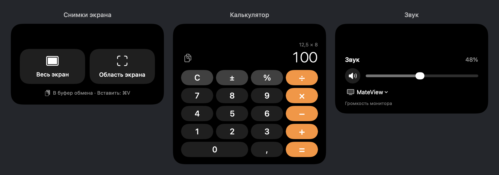
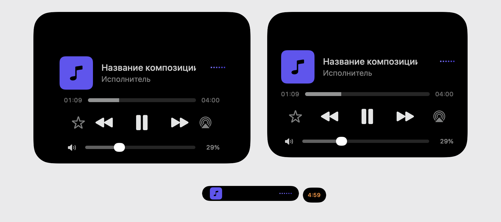

# DynamicNotch — community tools and trackpad fork

[Русский](README.md) · [Download](https://github.com/mortay21rus-hash/DynamicNotch/releases/tag/community-1.6.3-25.6.2) · [Maintainer notes](docs/UPSTREAM_NOTES.md)

I use DynamicNotch on my Mac and wanted quick access to screenshots, a calculator, monitor volume and video controls. I am publishing my modified version so the original developers can review the implementation, reproduce the fixed bugs and reuse the changes if useful.

**This is an unofficial modified fork of [jackson-storm/DynamicNotch](https://github.com/jackson-storm/DynamicNotch), not an official release.** It is based on 1.6.3 at [`deacd0f`](https://github.com/jackson-storm/DynamicNotch/commit/deacd0f4275c73ae5d3328491d23d0e0dc0f6970). Modification date: 2026-11-02. The original GNU GPL v3 license is retained.

## Changes

- Full-screen and region screenshots, with island windows hidden/excluded and PNG/TIFF clipboard output for ⌘V.
- A small `Decimal` calculator with keyboard input, percentages and result copying.
- System volume, mute and output routing, plus DDC/CI hardware volume for compatible external monitors. Hardware volume was tested on Huawei MateView; support for every monitor is not claimed.
- Horizontal two-finger timer adjustment using the existing ruler, with haptic feedback and no extra visible slider.
- Hover player with transport, seeking and volume. Swiping upward opens tools without stopping playback. Playback updates keep the tools session intact; closing restores the default player.
- Concurrent media and timer presentations, including an independently expandable timer companion.
- Five-second page retention after closing, then return to the first enabled page in the configured order. An open page does not expire.
- Expanded Russian localization.
- Fixes for false hover collapse, crossing/reversed page animations, calculator clipping, stale activity restoration and a retained lock-overlay crash caused by missing shared environment models.




## Download and build

The [community build](https://github.com/mortay21rus-hash/DynamicNotch/releases/tag/community-1.6.3-25.6.2) targets **Apple Silicon and macOS 26+**. It is ad-hoc signed, not Apple-notarized. Use the normal macOS Privacy & Security approval if Gatekeeper blocks the first launch. Keep only the intended app copy in Applications; store older builds as ZIP archives.

To build with Xcode's macOS 26 SDK and Python 3:

```bash
git clone --branch community-tools https://github.com/mortay21rus-hash/DynamicNotch.git
cd DynamicNotch
python3 scripts/build-community.py
```

The script creates a Release app and ZIP with license notices, verifies its signature, emits checksums and remaps the build user's source paths. Output: `build/community/`. Swift package revisions are pinned in the project's `Package.resolved`.

## Validation

```bash
bash tests/run-island-tools.sh
python3 tests/run-navigation-checks.py
python3 tests/run-activity-checks.py
python3 tests/run-presentation-checks.py
```

These focused standalone checks cover calculation, gestures, layout, screenshot-flow ordering, activity scheduling, real five-second waits, moving page renders and retained-window player rendering. Background services and outer input handling are replaced where needed; production window roots, media models and player views are used. No app-host copies are launched in the Dock.

I confirmed real video playback, player-to-tools swipes, clicks and page navigation on my Mac. The retained lock-overlay failure was reproduced and fixed in native rendering tests; a full physical lock/unlock cycle after the fix and end-to-end region-selection interaction are not separately claimed as verified.

See [maintainer notes](docs/UPSTREAM_NOTES.md) and the [upstream comparison](https://github.com/jackson-storm/DynamicNotch/compare/deacd0f4275c73ae5d3328491d23d0e0dc0f6970...mortay21rus-hash:community-tools).

## Credits

Original project: [jackson-storm/DynamicNotch](https://github.com/jackson-storm/DynamicNotch). Fork account: [mortay21rus-hash](https://github.com/mortay21rus-hash).

[GNU GPL v3](LICENSE) · [Third-party notices](NOTICE.md) · [Original README](README.upstream.md)
