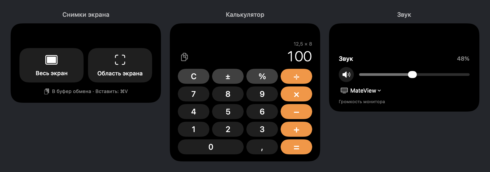
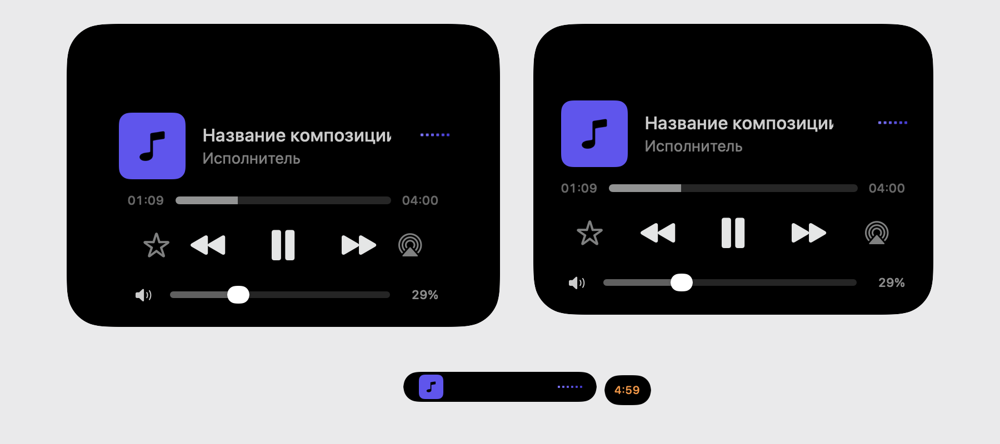

# DynamicNotch — мой форк с инструментами и жестами

[English](README.en.md) · [Скачать сборку](https://github.com/mortay21rus-hash/DynamicNotch/releases/tag/community-1.6.3-25.6.2) · [Что изменилось для разработчиков](docs/UPSTREAM_NOTES.md)

Я пользуюсь DynamicNotch на Mac и хотел, чтобы через остров можно было быстро сделать скриншот, посчитать что-нибудь, изменить громкость монитора и управлять видео. В этом форке собраны эти изменения, русификация и исправления жестов.

Публикую исходники и сборку, чтобы авторы оригинала могли посмотреть реализацию, воспроизвести исправленные ошибки и при желании перенести изменения в основной проект.

**Это неофициальная изменённая версия [jackson-storm/DynamicNotch](https://github.com/jackson-storm/DynamicNotch), а не официальный релиз.** Основа — 1.6.3, коммит [`deacd0f`](https://github.com/jackson-storm/DynamicNotch/commit/deacd0f4275c73ae5d3328491d23d0e0dc0f6970). Изменения опубликованы 2 ноября 2026 года. Лицензия оригинала, **GNU GPL v3**, сохранена.

## Что я добавил

| Возможность | Как работает |
| --- | --- |
| Скриншоты | Весь экран или выделенная область. Остров и его окна скрываются перед съёмкой. Картинка попадает в буфер обмена в PNG/TIFF — дальше можно нажать ⌘V. |
| Мини-калькулятор | Обычные вычисления, проценты, ввод с клавиатуры и копирование результата. Десятичные расчёты через `Decimal`. |
| Звук | Системная громкость, отключение звука и выбор устройства вывода. Для совместимого внешнего монитора — аппаратная громкость через DDC/CI. |
| Таймер | Значение меняется горизонтальной прокруткой двумя пальцами по существующей линейке. Отдельного видимого ползунка не добавлено. |
| Плеер | При воспроизведении наведение раскрывает управление: пауза, воспроизведение, предыдущий/следующий трек, перемотка и громкость. |
| Доступ к инструментам | Свайп двумя пальцами вверх по плееру открывает инструменты. Воспроизведение продолжается, обновления видео не перехватывают экран. После закрытия острова плеер снова становится экраном по умолчанию. |
| Два события | Музыка и таймер могут показываться одновременно: основной остров и отдельный индикатор таймера. Каждую часть можно раскрыть отдельно. |
| Запоминание страницы | Последняя страница сохраняется на пять секунд после закрытия, затем при открытии выбирается первая включённая страница в моём порядке. Открытая страница не сбрасывается. |
| Русский интерфейс | Дополнен перевод настроек, режимов и уведомлений; в проверенной сборке — 906 строк и 6 форм множественного числа. |





Изображения — отрисовки настоящих SwiftUI-компонентов с тестовыми данными, без личного содержимого экрана.

## Какие ошибки исправлены

- Перелистывание могло закрывать остров, хотя курсор оставался внутри. Проверка области взаимодействия теперь получает геометрию от владельца окна, без приведения `NSApp.delegate` к классу приложения: SwiftUI может оборачивать делегат.
- Страницы пересекались или двигались в разные стороны. Теперь они используют одно вертикальное смещение с пружиной и размытием; отдельные переходы вставки/удаления убраны.
- Калькулятор обрезался при изменении размеров острова. Высота содержимого и обработка жеста больше не зависят от смещения изменяемого `ScrollView`.
- После блокировки/разблокировки Mac раскрытие плеера могло завершить приложение с `No ObservableObject of type SoundControlModel found`. Сохранённое второе окно теперь получает те же модели звука и инструментов, что и основное.
- Завершившиеся музыка и таймер могли снова появиться после окончания анимации сворачивания. При восстановлении учитывается актуальный список событий.

## Скачать и запустить

[Community 1.6.3 — сборка 25.6.2](https://github.com/mortay21rus-hash/DynamicNotch/releases/tag/community-1.6.3-25.6.2)

Готовая сборка предназначена для **Apple Silicon и macOS 26 или новее**. Она подписана локальной ad-hoc подписью и не нотарифицирована Apple. Если macOS блокирует первый запуск, используйте штатное разрешение запуска в «Системные настройки → Конфиденциальность и безопасность».

Распакуйте архив и перенесите `DynamicNotch.app` в «Программы». Для запрошенных функций macOS может отдельно запросить разрешения. Старые сборки лучше хранить в ZIP-архивах, чтобы случайно не запускать другую копию с тем же идентификатором приложения.

Поддержка DDC зависит от монитора и подключения. Аппаратное изменение громкости проверено на Huawei MateView; универсальная поддержка всех мониторов не заявляется.

## Собрать из исходников

Нужны Apple Silicon, macOS 26+, Xcode с SDK macOS 26 и Python 3.12+.

```bash
git clone --branch community-tools https://github.com/mortay21rus-hash/DynamicNotch.git
cd DynamicNotch
python3 scripts/build-community.py
```

Скрипт собирает Release, создаёт ZIP с приложением и лицензиями, проверяет подпись, записывает SHA-256 и не включает в публичный бинарник путь к домашнему каталогу сборщика. Результат появляется в `build/community/`. Зависимости Swift Package Manager закреплены в `Package.resolved` проекта.

## Проверки

```bash
bash tests/run-island-tools.sh
python3 tests/run-navigation-checks.py
python3 tests/run-activity-checks.py
python3 tests/run-presentation-checks.py
```

Это автономные проверки: вычисления, жесты, геометрия, буфер скриншотов, сценарии движка, пятисекундное запоминание и отрисовка окон. Они не запускают отдельные копии приложения в Dock. При проверке представления заменяются фоновые службы и внешняя обработка жестов; настоящие модели, корневые представления окон и плеер остаются в тесте.

На моём Mac отдельно проверены работа плеера с видео, свайп к инструментам, клики и перелистывание. Сценарий сохранённого окна после разблокировки воспроизведён и проверен автоматизированно; полный цикл блокировки/разблокировки после исправления отдельно не подтверждался. Интерактивное выделение области скриншота также не заявляется как полностью автоматизированная проверка.

## Для авторов оригинала

- [Описание изменений, причин ошибок и границ проверки](docs/UPSTREAM_NOTES.md)
- [Сравнение с исходным коммитом](https://github.com/jackson-storm/DynamicNotch/compare/deacd0f4275c73ae5d3328491d23d0e0dc0f6970...mortay21rus-hash:community-tools)
- [Исходный README](README.upstream.md)

## Авторство и лицензия

Оригинальный DynamicNotch — проект [jackson-storm](https://github.com/jackson-storm/DynamicNotch). Этот форк поддерживается от моего аккаунта [mortay21rus-hash](https://github.com/mortay21rus-hash).

Код распространяется по [GNU GPL v3](LICENSE). Сведения о сторонних компонентах — в [NOTICE.md](NOTICE.md).
